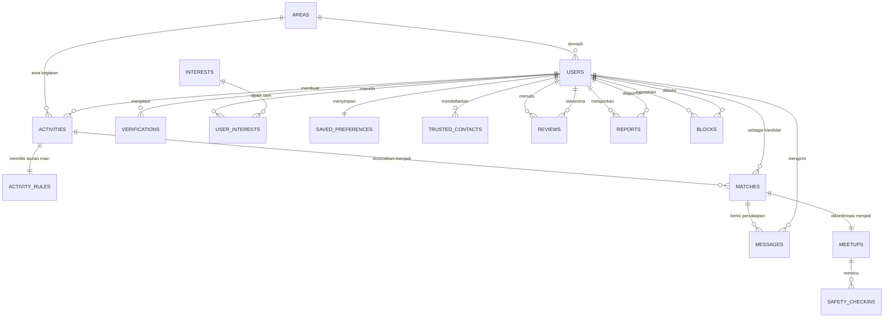

# ERD Temenin (Entity Relationship Diagram)
Versi 1.0, 27 Oktober 2026. Desain data untuk MVP hackathon Temenin dan fondasi produk jangka panjang.
Dokumen pendamping: PRD Temenin (kode FR dirujuk dari sana), UML Temenin, Rencana Pengembangan Temenin.

## 1. Prinsip desain data
- Tidak ada koordinat presisi user di basis data. Lokasi hanya berupa area kecamatan beserta titik tengah area itu di tabel `areas`, sesuai prinsip privasi PRD (NFR-01).
- Detail sensitif aktivitas (lokasi dan waktu) tidak disimpan terpisah dari aktivitasnya; yang mengatur keterlihatannya adalah status verifikasi penampil, diterapkan di lapisan aplikasi. Model datanya tetap satu, aturan tampilnya berlapis.
- Status verifikasi adalah data turunan dari tabel `verifications`, dicerminkan ke `users.verification_status` untuk kemudahan baca.
- Skor kepercayaan (`trust_score`) dan skor keandalan (`reliability_score`) pada `users` adalah nilai agregat yang diperbarui dari `reviews` dan `meetups`, disimpan sebagai cache terhitung, bukan satu-satunya sumber kebenaran.
- Untuk MVP, data demo (persona seeded) memakai skema yang sama persis dengan data user nyata, ditandai `is_demo_persona`.

## 2. Diagram (Mermaid ERD)

## 3. Daftar entitas dan atribut
Konvensi: PK = primary key, FK = foreign key. Tipe ditulis generik (setara Postgres/Supabase yang direncanakan).

### 3.1 areas
Area level kecamatan/kawasan, satu-satunya representasi lokasi di sistem.
- `id` (PK, uuid)
- `name` (text) — nama kecamatan/kawasan, misalnya "Tebet"
- `city` (text) — misalnya "Jakarta Selatan"
- `center_lat` (numeric) — titik tengah area, bukan lokasi user
- `center_lng` (numeric)
- `zone` (text) — pengelompokan zona demo, misalnya "Jaksel", "Depok", "Tangerang"

### 3.2 users
- `id` (PK, uuid)
- `name` (text)
- `gender` (enum: female, male) — dipakai preferensi gender pada matching
- `birth_date` (date) — untuk gerbang usia 18+ (FR-01)
- `area_id` (FK ke areas)
- `avatar_type` (enum: photo, initial)
- `avatar_url` (text, nullable)
- `mbti` (text, nullable) — opsional, boleh kosong (FR-02)
- `energy_profile` (jsonb) — hasil kuis: social_energy, chat_style, spontaneity, indoor_outdoor (FR-03)
- `safety_preferences` (jsonb) — hanya tempat publik, mode yang diizinkan, preferensi partner
- `verification_status` (enum: unverified, pending, verified)
- `trust_score` (numeric, 0–5) — agregat dari reviews (FR-25)
- `reliability_score` (numeric, 0–100) — persentase rencana terlaksana (FR-26)
- `activities_completed` (integer)
- `is_demo_persona` (boolean)
- `created_at` (timestamp)

### 3.3 verifications
- `id` (PK, uuid)
- `user_id` (FK ke users)
- `method` (enum: simulated) — MVP hanya simulasi berlabel; nilai lain untuk roadmap KYC
- `id_document_ref` (text, nullable) — referensi dokumen pada mode simulasi berisi penanda simulasi, bukan berkas asli
- `selfie_ref` (text, nullable)
- `status` (enum: submitted, approved, rejected)
- `verified_at` (timestamp, nullable)
- `created_at` (timestamp)

### 3.4 interests dan user_interests
`interests`: `id` (PK), `slug` (text, unik), `label_en` (text), `label_id` (text).
`user_interests`: `user_id` (FK), `interest_id` (FK), PK gabungan (user_id, interest_id).

### 3.5 saved_preferences
Preferensi tersimpan dari Save Preference (FR-05, FR-10). Satu baris per user.
- `id` (PK, uuid)
- `user_id` (FK ke users, unik)
- `chat_level` (enum: quiet, moderate, chatty)
- `mbti_preference_mode` (enum: any, same_as_me, specific)
- `mbti_specific_types` (jsonb, array teks, nullable)
- `required_interest_id` (FK ke interests, nullable)
- `mode` (enum: one_on_one, small_group, any)
- `radius_option` (enum: own_area, km5, km10, km25, jabodetabek)
- `radius_hard_filter` (boolean)
- `gender_preference` (enum: any, female, male)
- `gender_hard_filter` (boolean)
- `updated_at` (timestamp)

### 3.6 trusted_contacts
- `id` (PK, uuid)
- `user_id` (FK ke users)
- `name` (text)
- `channel` (enum: whatsapp, sms, email)
- `destination` (text) — nomor atau alamat tujuan
- `created_at` (timestamp)

### 3.7 activities
- `id` (PK, uuid)
- `creator_id` (FK ke users)
- `category` (enum: movie, coffee, study, shopping, sports, food, music, other)
- `description` (text) — satu-satunya bagian yang terlihat oleh penampil belum terverifikasi (FR-12)
- `starts_at` (timestamp) — waktu aktivitas, sensitif, disembunyikan sebelum verifikasi penampil
- `area_id` (FK ke areas) — sensitif seperti waktu
- `venue_name` (text, nullable) — titik temu persis, hanya tampil setelah meetup terkonfirmasi dua arah (FR-20)
- `budget_min`, `budget_max` (integer, IDR)
- `party_size_target` (integer)
- `source` (enum: form, free_text) — cara pembuatan (FR-06, FR-07)
- `status` (enum: open, matched, confirmed, completed, cancelled)
- `created_at` (timestamp)

### 3.8 activity_rules
Aturan Main per aktivitas (FR-08, FR-09, FR-11, FR-14). Satu baris per aktivitas, strukturnya sejajar dengan `saved_preferences` supaya hasil Save Preference dapat menyalin langsung.
- `id` (PK, uuid)
- `activity_id` (FK ke activities, unik)
- `chat_level` (enum: quiet, moderate, chatty)
- `chat_level_required` (boolean)
- `mbti_preference_mode` (enum: any, same_as_me, specific)
- `mbti_specific_types` (jsonb, nullable)
- `mbti_required` (boolean)
- `required_interest_id` (FK ke interests, nullable)
- `required_interest_mandatory` (boolean)
- `mode` (enum: one_on_one, small_group, any)
- `mode_required` (boolean)
- `radius_option` (enum: own_area, km5, km10, km25, jabodetabek)
- `radius_hard_filter` (boolean)
- `gender_preference` (enum: any, female, male)
- `gender_hard_filter` (boolean)
- Catatan penegakan: jumlah bidang non-gender dengan status required dibatasi maksimal 2, divalidasi di lapisan aplikasi.

### 3.9 matches
Hasil perhitungan matching engine untuk pasangan (aktivitas, kandidat).
- `id` (PK, uuid)
- `activity_id` (FK ke activities)
- `candidate_user_id` (FK ke users)
- `score_total` (numeric)
- `score_gender` (numeric) — komponen 30% (FR-13, FR-14)
- `score_interest` (numeric) — 25%
- `score_energy` (numeric) — 20%
- `score_context` (numeric) — 15%, termasuk radius dan pita jarak
- `score_trust` (numeric) — 10%
- `distance_band` (enum: same_area, km3_5, km5_10, km10_25, beyond) — pita jarak, bukan angka presisi (FR-17)
- `rules_checklist` (jsonb) — daftar syarat dan status terpenuhi per syarat (FR-16)
- `outside_gender_preference` (boolean) — untuk label terbuka di UI
- `explanation` (text) — penjelasan natural AI, atau hasil fallback/cache
- `icebreakers` (jsonb, array teks)
- `status` (enum: suggested, selected, rejected)
- `created_at` (timestamp)

### 3.10 messages
- `id` (PK, uuid)
- `match_id` (FK ke matches)
- `sender_id` (FK ke users)
- `body` (text)
- `held_by_filter` (boolean) — true bila pesan ditahan filter info kontak (FR-19)
- `held_reason` (enum: phone_pattern, social_handle, ai_safety_check, nullable) — nilai ai_safety_check dipakai bila penahanan diputuskan lapisan AI Safety Check (FR-27)
- `created_at` (timestamp)

### 3.11 meetups
Konfirmasi pertemuan dari sebuah match.
- `id` (PK, uuid)
- `match_id` (FK ke matches, unik)
- `venue_name` (text) — dari rekomendasi tempat publik
- `venue_area_id` (FK ke areas)
- `scheduled_at` (timestamp)
- `checklist_completed_by_creator` (boolean)
- `checklist_completed_by_candidate` (boolean)
- `confirmed_by_creator_at` (timestamp, nullable)
- `confirmed_by_candidate_at` (timestamp, nullable) — titik temu persis terbuka bila kedua kolom ini terisi (FR-20)
- `plan_shared_at` (timestamp, nullable) — waktu tombol bagikan rencana dipakai (FR-21)
- `status` (enum: pending_confirmation, confirmed, completed, cancelled, no_show)
- `created_at` (timestamp)

### 3.12 safety_checkins
- `id` (PK, uuid)
- `meetup_id` (FK ke meetups)
- `user_id` (FK ke users)
- `status` (enum: prompted, arrived_safe, completed_safe, no_response)
- `responded_at` (timestamp, nullable)
- `created_at` (timestamp)

### 3.13 reviews
- `id` (PK, uuid)
- `meetup_id` (FK ke meetups, nullable bila ulasan tidak terikat meetup tertentu)
- `activity_id` (FK ke activities)
- `reviewer_id` (FK ke users)
- `reviewee_id` (FK ke users)
- `rating` (integer, 1–5)
- `tags` (jsonb, array teks) — misalnya "tepat waktu", "bikin nyaman"
- `comment` (text, nullable)
- `reported_no_show` (boolean) — menurunkan reliability_score pihak yang diulas (FR-26)
- `created_at` (timestamp)

### 3.14 reports dan blocks
`reports`: `id` (PK), `reporter_id` (FK), `reported_user_id` (FK), `match_id` (FK, nullable), `reason` (text), `status` (enum: open, reviewed, closed), `created_at`.
`blocks`: `blocker_id` (FK), `blocked_user_id` (FK), PK gabungan, `created_at`. Pasangan yang saling terhubung lewat blocks tidak ditampilkan satu sama lain (FR-23).

## 4. Relasi kunci dan kardinalitas
- Satu user berdomisili di satu area; satu area menampung banyak user dan banyak aktivitas.
- Satu user memiliki tepat satu `saved_preferences` dan dapat mendaftarkan banyak `trusted_contacts`.
- Satu aktivitas memiliki tepat satu `activity_rules` dan menghasilkan banyak `matches` (satu per kandidat).
- Satu match memiliki satu rangkaian `messages` dan maksimal satu `meetups`.
- Satu meetup menghasilkan `safety_checkins` untuk kedua pihak dan menjadi dasar `reviews` dua arah.
- `reviews` memperbarui agregat `trust_score` dan `reliability_score` pada user yang diulas.

## 5. Catatan implementasi MVP
- Untuk demo, seluruh tabel di atas dapat direpresentasikan sebagai berkas JSON seeded tanpa basis data server; skema ini menjadi kontrak bila migrasi ke Supabase dilakukan setelah checkpoint 30 Okt.
- Indeks yang disarankan untuk produk nyata: `activities(status, area_id)`, `matches(activity_id, score_total)`, `messages(match_id, created_at)`.
- Baris `verifications` pada produk nyata mengikuti kebijakan retensi PRD Bagian 6.2: berkas ID tidak disimpan permanen; yang dipertahankan adalah status dan cap waktunya.
