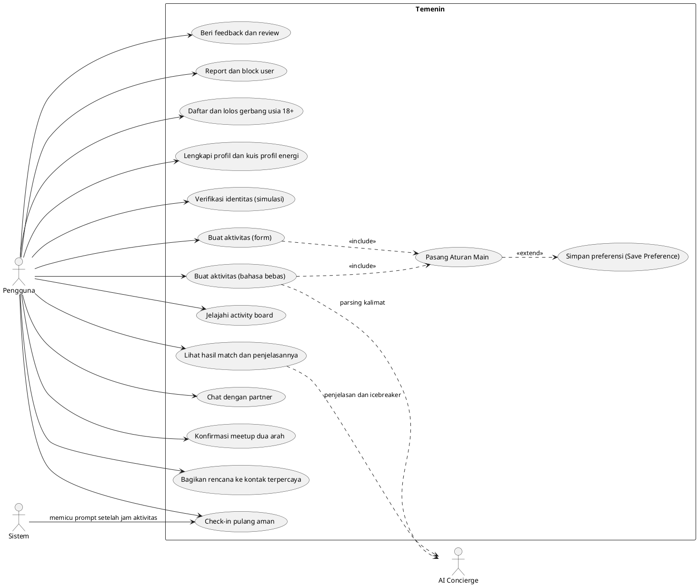
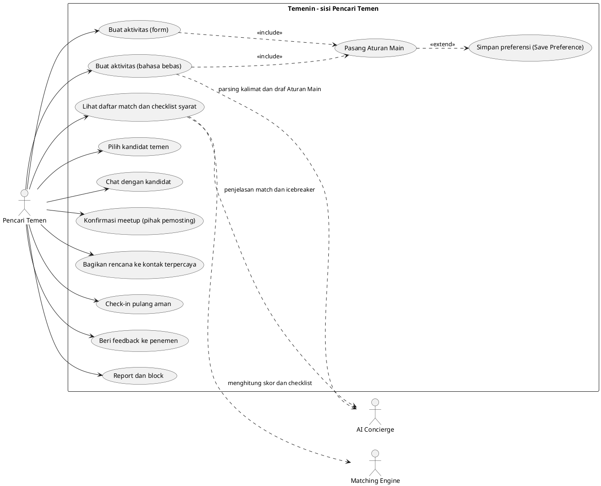
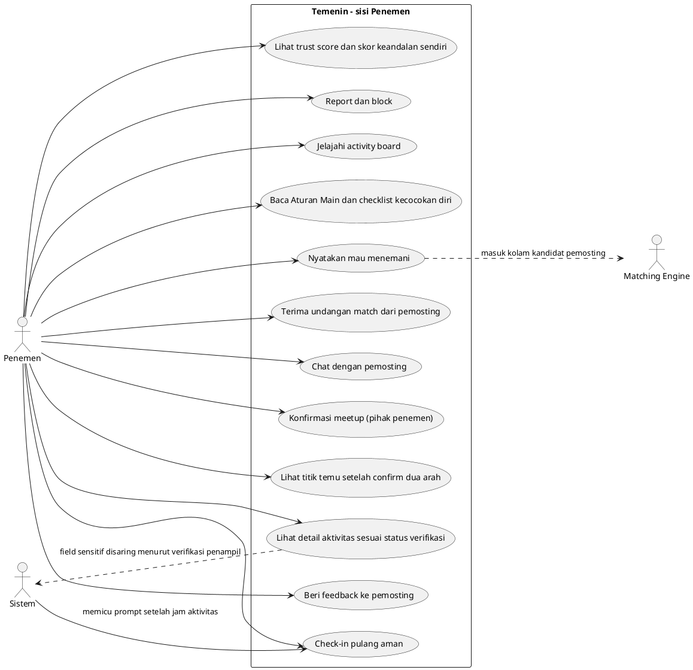
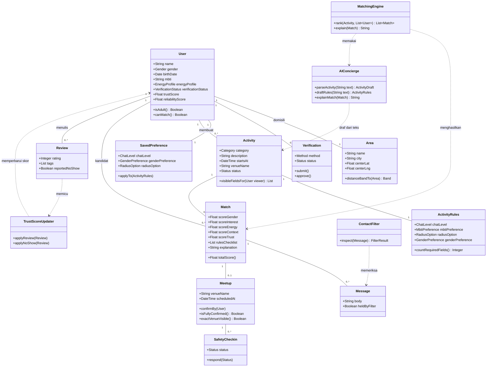
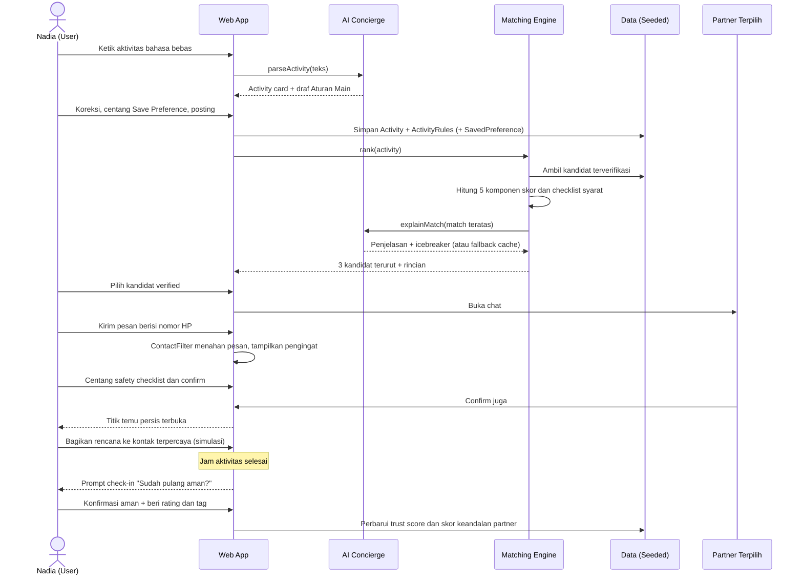
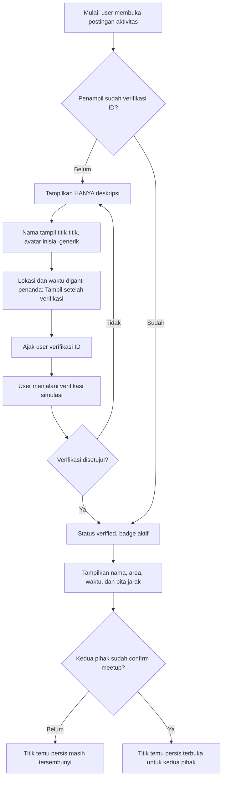
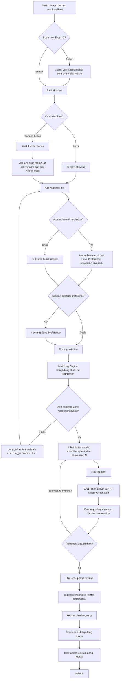
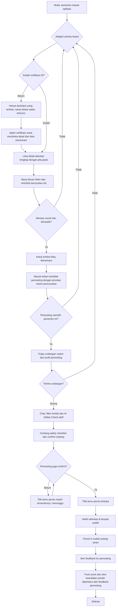
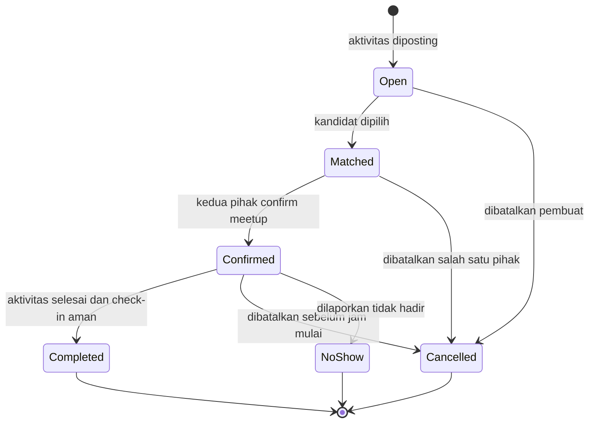

# UML Temenin
Versi 1.0, 27 Oktober 2026. Kumpulan diagram UML untuk MVP Temenin: Use Case Diagram (gabungan dan per peran: Pencari Temen dan Penemen), Class Diagram, Sequence Diagram, Activity Diagram (pengungkapan bertahap dan per peran), dan State Diagram.
Dokumen pendamping: PRD Temenin (kode FR), ERD Temenin, Rencana Pengembangan Temenin.
Konvensi: Use Case ditulis dalam sintaks PlantUML, diagram lain dalam sintaks Mermaid, keduanya dapat dirender di GitHub, VS Code, dan perangkat UML umum.

## 1. Use Case Diagram
Aktor: Pengguna (user terverifikasi maupun belum), AI Concierge (sistem eksternal), Sistem (proses internal terjadwal/otomatis).

Ringkasan use case dan kaitannya ke PRD:
- UC1–UC2: onboarding dan profil (FR-01, FR-02, FR-03).
- UC3: syarat sebelum match (FR-04).
- UC4–UC7: pembuatan aktivitas, Aturan Main, Save Preference (FR-06 sampai FR-11).
- UC8: activity board dengan tampilan berbasis verifikasi penampil (FR-12).
- UC9: matching dan penjelasan (FR-13 sampai FR-17).
- UC10–UC11: chat terfilter dan konfirmasi dua arah (FR-18, FR-19, FR-20).
- UC12–UC13: keamanan pertemuan (FR-21, FR-22).
- UC14: feedback, trust score, skor keandalan (FR-24, FR-25, FR-26).
- UC15: report dan block (FR-23).

### 1.1 Use Case Diagram per peran: Pencari Temen (pemosting aktivitas)
Peran ini membuat aktivitas dan memilih siapa yang menemaninya.

### 1.2 Use Case Diagram per peran: Penemen (yang mau menemani)
Peran ini menemukan aktivitas orang lain dan menawarkan diri untuk menemani. Mekanisme keterlibatannya: penemen menekan tombol "Mau Menemani" pada sebuah aktivitas untuk masuk ke kolam kandidat pemosting (dengan prioritas dari mesin pencocokan), lalu menerima atau menolak undangan match dari pemosting. Ini penjabaran dari kemampuan "menerima permintaan match" pada FR-04.

Use case yang dipakai bersama oleh kedua peran (tidak digambar ulang di dua diagram peran): pendaftaran dan gerbang usia 18+ (UC1), lengkapi profil dan kuis profil energi (UC2), dan verifikasi identitas (UC3). Keduanya adalah syarat sebelum peran mana pun dapat berjalan penuh.

## 2. Class Diagram (Mermaid)
Kelas di bawah ini sejajar satu-satu dengan entitas ERD; atribut diringkas ke yang relevan untuk perilaku sistem.

Perilaku penting yang diwakili diagram:
- `Activity.visibleFieldsFor(viewer)` menerapkan aturan privasi FR-12: penampil belum terverifikasi hanya menerima deskripsi.
- `Meetup.exactVenueVisible()` hanya benar bila kedua pihak sudah confirm (FR-20).
- `ContactFilter` berdiri di jalur pengiriman `Message` sebelum meetup terkonfirmasi (FR-19).

## 3. Sequence Diagram: alur demo utama (Mermaid)

## 4. Activity Diagram: verifikasi dan pengungkapan bertahap (Mermaid)

### 4.1 Activity Diagram per peran: Pencari Temen (pemosting aktivitas)

### 4.2 Activity Diagram per peran: Penemen (yang mau menemani)

Perbedaan kunci kedua peran: pencari temen memegang kendali memilih kandidat dan memasang Aturan Main, sedangkan penemen memegang kendali menerima atau menolak undangan. Kendali keamanan dibagi rata: checklist, confirm, dan check-in wajib dilakukan kedua pihak, dan titik temu persis hanya terbuka bila keduanya sudah confirm.

## 5. State Diagram: siklus hidup aktivitas (Mermaid)

Transisi Completed dan NoShow adalah pemicu pembaruan skor keandalan pada FR-26.
