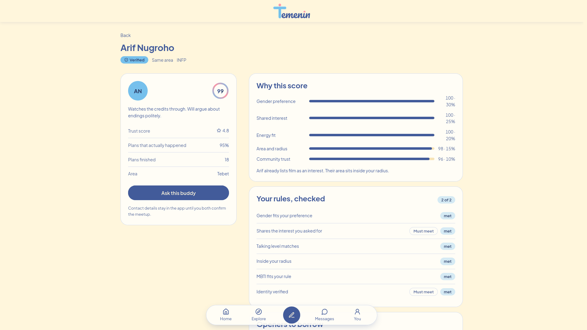

# Temenin

Find a verified **activity buddy** for the plan you already have. You post the plan, Temenin ranks people, and names, places, and times stay sealed until both sides are verified.

Tagline: *Vibes click. Plans stick.* / *Energinya klik, rencananya jalan.*

**Live demo:** https://temenin-hackathon.vercel.app/ · **Demo video (3 min):** https://youtu.be/0_ITuyDeiBk



> Built for Meta Global AI Developer Hackathon — Indie developer track, Build for Your World theme. Kickoff 26 Oct 2026; building 26 Oct – 4 Nov 9PM ET (deadline 5 Nov 09:00 WIB); judging 4–8 Nov; winners 9 Nov. Spec lives in `AGENT/01-brand-identity-temenin.md` through `AGENT/06-uml-temenin.md`.

> Track: Indie developer · Theme: Build for Your World. Submission (hackathon portal, due 4 Nov 9PM ET): [public repo](https://github.com/Dobydoo/temenin) + [live demo](https://temenin-hackathon.vercel.app/) + [demo video](https://youtu.be/0_ITuyDeiBk) + this README. Live run below is 60 seconds; recorded submission video is 3 minutes (same 7-step story, extended cut). Demo script: `docs/demo-video-script.md`, captions: `docs/demo/captions.srt`.

1. Open `/` and pick **Nadia (unverified)** in the gate dialog. Board cards show description only, name/area/time locked.
2. Open the account menu → **Log out**, then pick **Arif (verified)** in the gate dialog. Same board opens with names, areas, times.
3. `/create`: type `Sabtu sore mau nonton di Tebet, budget 100 ribuan, pengen teman yang asik diajak ngobrol setelah film.` → draft card (category, area, budget, chat level), then set Aturan Main with must-meet / bonus toggles.
4. `/match/a-sekar-coffee`: deterministic score + checklist. `/match/a-sekar-coffee/detail?candidate=u-arif`: five score bars, explainers, 3 openers, 3 curated public venues, safety checklist.
5. `/messages/[id]` (via **Ask this buddy**): chat holds phone numbers and social handles until two-sided confirm. Exact venue opens only after both confirm. Share plan, finish, check in.
6. `/feedback/[id]` → stars, tags, one line, no-show report (stored locally).
7. `/safety` runs the simulated ID check (pending → verified).

## Stack

Next.js 16.4.3 (App Router) + React 19 + TypeScript strict + Tailwind CSS 4 + Zod + lucide-react. Fonts via `next/font`: Plus Jakarta Sans (UI) + Pacifico (wordmark). No database or external backend; only Next.js API routes for the optional AI calls below (live Meta Model API calls only when `META_MODEL_URL` + `META_MODEL_API_KEY` are set, otherwise deterministic local fallback). Security headers (CSP, `X-Content-Type-Options`, `Referrer-Policy`, `X-Frame-Options`) in `next.config.ts`.

## Run it

Requires Node 20.9+ (24 recommended, see `.nvmrc`).

```bash
npm install
npm run dev      # http://localhost:3000
```

Optional live AI: copy `.env.example` to `.env.local` and set `META_MODEL_URL` + `META_MODEL_API_KEY`. Without keys the app runs fully on the deterministic local fallback.

```bash
npm run typecheck   # tsc --noEmit, strict
npm run lint        # eslint
npm test            # node:test via tsx, 32 tests (engine 20, rate-limit 3, social 4, storage 5)
npm run smoke       # headless Chrome walkthrough of the 7-step demo (needs dev server in a second terminal + /usr/bin/google-chrome; on macOS install Chrome or symlink it there)
npm run build && npm run start
```

## Routes

| Screen | Route | What it does |
| --- | --- | --- |
| Board | `/` | Plans sealed to description until the viewer verifies. Demo gate offers Nadia (unverified) vs Arif (verified). |
| Explore | `/explore` | Filters by activity category and Jabodetabek zone. |
| Trending | `/trending` | Globe map of trending hangout spots with popups (demo data). |
| Create | `/create` | Free-text parsed by `parseFreeText()` into a draft card, then Aturan Main per plan with required/bonus toggles and Save Preference. |
| Matches | `/match/[id]` | `rankCandidates()` order and rules checklist. Join/request + host approve flow. |
| Match detail | `/match/[id]/detail?candidate=` | Five score bars via `scoreRows()`, rules checklist, explanation, 3 icebreakers, top-3 venues from the curated list, safety checklist, share-plan button. |
| Chat | `/messages`, `/messages/[id]` | Thread with `inspectMessage()` contact filter, two-sided meetup card, exact venue only after both confirmations, plan share, finish and check-in. |
| Feedback | `/feedback/[id]` | Stars, quick tags, one line, no-show report — stored locally; trust display is static in this build. |
| Safety center | `/safety` | Simulated ID check (pending → verified), trusted contact, safety checklist, reliability. |
| Profile | `/you` | Name, area, MBTI (optional), 4-question energy quiz, interests, saved rules, locale, appearance. Login gate lives in `components/Gate.tsx` (no `/onboarding` route in this build). |

## Where the rules actually live

- **Scoring** — `lib/engine.ts`. `WEIGHTS = { gender: 0.3, interest: 0.25, energy: 0.2, context: 0.15, trust: 0.1 }`. Pure functions: `composeMatch`, `rankCandidates`, `parseFreeText`, `inspectMessage`, `recommendVenues`. No AI, fully deterministic.
- **Privacy boundary** — `lib/privacy.ts`. `visibleActivityFor()` returns description only to unverified viewers, so a rendering bug cannot leak name/area/time. `exactVenueVisible()` unlocks the meeting point only when both confirmations exist.
- **Contact filter** — `inspectMessage()` in `lib/engine.ts`. Holds phone patterns (digits, spelled-out `nol/satu/...`, spaced/dotted) and social handles (`@handle`, ig/wa/telegram/line) until the meetup is confirmed. Pattern filter, not an AI call.
- **Venues** — `recommendVenues()` ranks only the curated `VENUES` list inside the plan's area (category match + budget band), so the app never invents a place.
- **Distances** — `distanceBand()` between district centers only, rendered as bands (`Satu area`, `Sekitar 3 sampai 5 km`, …). No precise numbers, no live location.

## Demo data

- 19 users (`lib/data/users.ts`): 18 seeded personas (17 verified; Reza stays unverified to demo sealed cards) + viewer Nadia (unverified).
- 16 districts across Jakarta, Depok, Tangerang Selatan, Bekasi (`lib/data/areas.ts`).
- 21 curated public venues (`lib/data/venues.ts`).
- 160 board activities (10 curated seeds in `lib/store.tsx` + 150 generated in `lib/data/board.ts`).
- All names are fictional demo personas. Verification is labeled simulated in the UI.

State lives in `localStorage` under `temenin.state.v6` (`STORAGE_KEY` in `lib/storage.ts`; legacy `v5`/`v2` keys migrate forward). Nothing is sent to a server. Reset: clear site data in the browser.

## Design system

Palette: navy `#425B9A`, sky `#76C0EC`, cream `#FFF6DC`, pink `#FF95A5`. Plus Jakarta Sans for text, Pacifico for wordmark, Lucide icons, no emoji and no em-dashes in UI copy. Tokens in `app/globals.css` (`:root` + `[data-mode="dark"]`, OS preference default with persisted manual override). Bilingual EN/ID via `lib/i18n.ts`. Brand assets in `public/brand/`.

## Docs

- `AGENT/00-daftar-isi.md` — index of the six spec docs.
- `AGENT/01-brand-identity-temenin.md` — logo, palette, tagline, privacy rules.
- `AGENT/02-layout-guide-temenin.md` — breakpoints, nav, type scale, dark mode mapping.
- `AGENT/03-rencana-pengembangan-temenin.md` — positioning, 7-step demo story, MVP scope, timeline.
- `AGENT/04-prd-temenin.md` — PRD, FR-01 to FR-30, NFRs.
- `AGENT/05-erd-temenin.md` — 14 entities, Mermaid ERD.
- `AGENT/06-uml-temenin.md` — use case, class, sequence, activity, state diagrams.

## Hackathon entry (Official Rules)

- Track: Indie developer. Theme: Build for Your World (urban loneliness: plans die without a verified activity buddy).
- Judging map: Impact 30% (verified-buddy safety story, sealed plans until verified), Meta AI Tooling 25% (four live calls below, graceful fallback), Technical Depth 20% (deterministic scoring + privacy enforced in `lib/privacy.ts`), Demo 25% (60-sec live run + recorded video, submission portal requires working demo + demo video).
- Dates (ET): kickoff 26 Oct; build 26 Oct–4 Nov 9PM ET; judging 4–8 Nov; winners 9 Nov.

## AI calls (Meta hackathon)

- `POST /api/ai/parse` (FR-07): tries Meta Model API (`META_MODEL_URL`, `META_MODEL_API_KEY`, optional `META_MODEL_NAME`, default `muse-spark`) 8s timeout, Zod validation, 20 req/min per IP, sanitized to known category/area/budget/chat enums. No key set means deterministic `parseFreeText()` fallback, so demo never depends on live API (NFR-04). `/create` uses it as progressive enhancement over local parse.
- `POST /api/ai/reason` (FR-16): rewrites match explanation warmer in one sentence (locale-aware), same timeout/rate-limit/Zod envelope. Used by `MatchReason` as progressive enhancement over rule-based line.
- `POST /api/ai/safety` (FR-27): second-layer AI check for messages the pattern filter flags as suspicious-but-unclear (spelled-out numbers, spaced/dotted digits, push to move off app). Runs only after `inspectMessage()` passes and before meetup confirm; `heldReason: "ai_safety_check"` carries the AI badge. Miss or no key keeps the pattern verdict.
- `POST /api/ai/venues` (FR-28): ranks the curated `VENUES` list for the plan's area (id-only ordering, never invents places) plus one contextual line for the top pick. `/match/[id]/detail` applies the order only on `"ai"`, else the curated default.
- Response contract (all four): `source` is `"ai"` only when the live model produced the payload; `MOCK_AI=true` returns `source: "fallback"` with `mock: true` so no AI badge ever shows without a real model. Clients apply payload only on `"ai"`.

## Not in scope

No live location, no precise coordinates, no payments, no real KYC vendor, no public registration, no Supabase migration. The AI calls in the PRD (free-text parsing, match explanation, safety check, venue reasoning) run here as deterministic fallbacks so the demo never depends on a live API.

## License

MIT — see [LICENSE](LICENSE).
